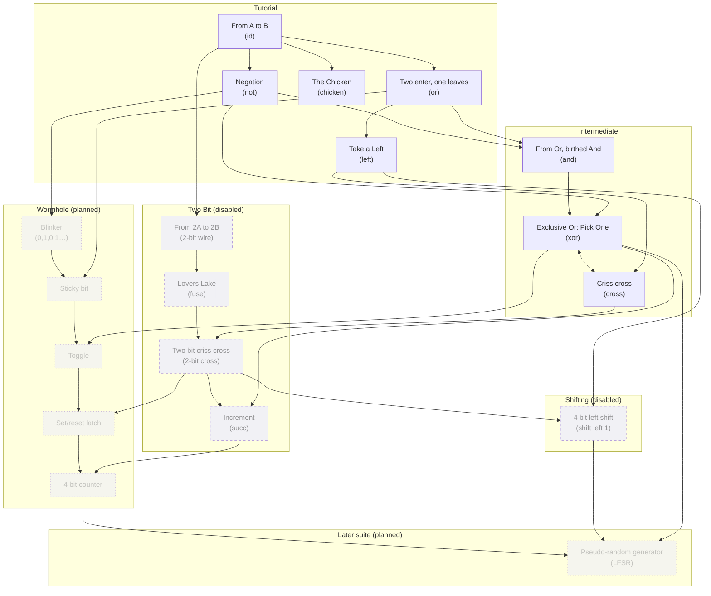

# Level Progression

Levels are grouped into suites under `src/Resources/LevelSuites/`, and the suites are listed in `allLevelSuites` in `src/Resources/LevelSuites.purs`. Only **Tutorial** and **Intermediate** are turned on right now. **Two Bit** and **Shifting** are written but commented out.

Progress is a `Completed`/`Incomplete` flag per level, stored in localStorage (`Capability/Progress.purs`). Nothing is locked: any level can be played in any order. The graph below shows the order levels are *meant* to be played in.

## Dependency graph

An arrow `A --> B` means B relies on A, for one of two reasons:
- B gives you A's goal piece to use, or
- B uses a mechanic that A teaches (drawing paths, 2-bit capacity, fuse/sever).

Xor and cross-over depend on each other, so they're joined by a dotted two-way link (see [Notes](#notes)).

## Suites

### Tutorial (enabled)

| # | Level | Goal | Available pieces | Inputs | Depends on |
|---|---|---|---|---|---|
| 1 | From A to B | `idPiece` | — (draw paths) | Left | — |
| 2 | Negation | `notPiece` | not | Left | From A to B |
| 3 | Two enter, one leaves | `orPiece` | or | Left, Up | From A to B |
| 4 | Take a Left | `leftPiece` | or | Left | Two enter, one leaves |
| 5 | The Chicken | `chickenPiece` | — | Left, Right | From A to B |

"From A to B" comes with a video demonstration (`new_path.mp4`).

### Intermediate (enabled)

| # | Level | Goal | Available pieces | Inputs | Depends on |
|---|---|---|---|---|---|
| 1 | Criss cross | `crossPiece` | id, super, left, right, xor | Left, Up | Take a Left, Exclusive Or (mutual) |
| 2 | From Or, birthed And | `andPiece` | or, not | Left, Up | Negation, Two enter one leaves |
| 3 | Exclusive Or: Pick One | `xorPiece` | id, not, or, and, cross | Left, Up | From Or birthed And, Negation, Criss cross (mutual) |

Criss cross also forbids using `crossPiece` itself (via `otherRestrictions`).

### Two Bit (disabled)

| # | Level | Goal | Available pieces | Inputs | Depends on |
|---|---|---|---|---|---|
| 1 | From 2A to 2B | 2-bit wire | id | Left: 0–3 | From A to B |
| 2 | Lovers Lake | `fusePiece` | fuse, id | Left: 0–3 | From 2A to 2B |
| 3 | Two bit criss cross | `twoBitCrossOver` | sever, fuse, id | Left: 0–3 | Lovers Lake, Criss cross |
| 4 | Increment | `succPiece` | xor, not, fuse, sever | Left: 0–3 | Two bit criss cross, Exclusive Or |

### Shifting (disabled)

| # | Level | Goal | Available pieces | Inputs | Depends on |
|---|---|---|---|---|---|
| 1 | 4 bit left shift | `mkShiftLeftBy 1 FourBit` | sever, fuse, id, left, right | Left: 0,1,2,3,8,9,15 | Two bit criss cross, Take a Left |

### Wormhole (planned)

To be built once wormholes are fully implemented (see [wormholes.md](wormholes.md)). Every level here is sequential: each test case is a sequence of frames, one frame per tick, and the stored value starts at `zero`.

**Side budget:** the wormhole takes two of the four sides, which leaves either one input and one output, or no input and one or two outputs. A level that needs two controls must pack them into one 2-bit input and split it with sever.

| # | Level | Behaviour | Harness I/O | Likely pieces | Depends on |
|---|---|---|---|---|---|
| 1 | Blinker | Output 0,1,0,1… with no input | out: 1-bit | not | Negation |
| 2 | Sticky bit | Output 1 forever once the input has been 1 | in: 1-bit, out: 1-bit | or | Blinker, Two enter one leaves |
| 3 | Toggle | Flip the stored bit whenever the input is 1 | in: 1-bit, out: 1-bit | xor | Sticky bit, Exclusive Or |
| 4 | Set/reset latch | Set: store 1. Reset: store 0. Neither: keep the stored bit | in: 2-bit (set, reset), out: 1-bit | sever, and, or, not | Toggle, Two bit criss cross |
| 5 | 4 bit counter | Output 0,1,2,…,15,0,… | out: 4-bit | succ (4-bit), or build one | Set/reset latch, Increment |

To decide when these are built:
- **Set/reset:** what happens when set and reset are both on.
- **Counter:** whether it counts every tick, or only on ticks where a 1-bit "count" input is on.
- **Prerequisites:** set/reset and the counter build on the Two Bit suite, which is currently disabled.

Ideas not chosen for now:
- **Echo / delay:** hard to show visually.
- **Edge detectors, two-in-a-row, latch with enable, clock divider, shift-register levels (2-tick delay, pattern detector, majority of last 3).**
- **Integrator:** probably too hard without an adder piece.

### Later suite (planned)

| Level | Behaviour | Harness I/O | Likely pieces | Depends on |
|---|---|---|---|---|
| Pseudo-random generator | A shift register whose new bit is the xor of two of its own bits (an LFSR). Outputs a fixed sequence that looks random | out: 4-bit (or 1-bit) | shift, xor, sever, fuse | 4 bit counter, 4 bit left shift, Exclusive Or |

## Notes

- **Xor and cross-over need each other.** On a flat grid, building xor from or/and/not needs wires to cross, and a cross-over can be built from three xors (the XOR-swap trick). So each of these levels gives you the other piece. Still to decide: which one the player gets as a given piece first.
- **Pieces offered but never taught:** `superPiece` (Criss cross) and `rightPiece` (Criss cross, 4 bit left shift). Take a Left arguably covers right.
- **Take a Left only offers `orPiece`.** This looks like a copy-paste mistake. Take a Left and The Chicken also have empty descriptions.
- **Name mismatch:** the level key "Criss cross" doesn't match its title, "Cross over".
- **Junk text:** the Shifting level's description ends in "bluefdsajafdskl".
- **Module name mismatch:** `TutorialSuite.purs` declares `module Resources.LevelSuites.TutorialSuite.Suite`.
- **Order in the level select:** suites are `Foreign.Object`s, so levels are listed in the order their keys are written in the source file.
