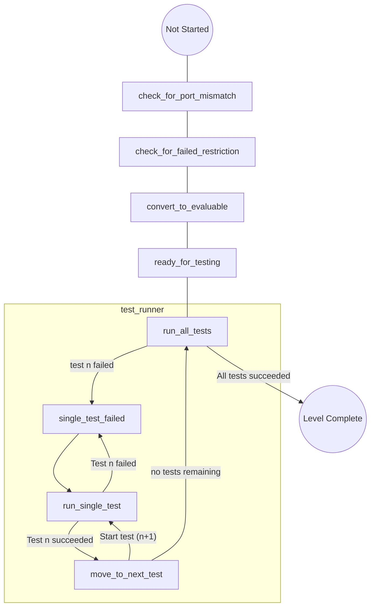
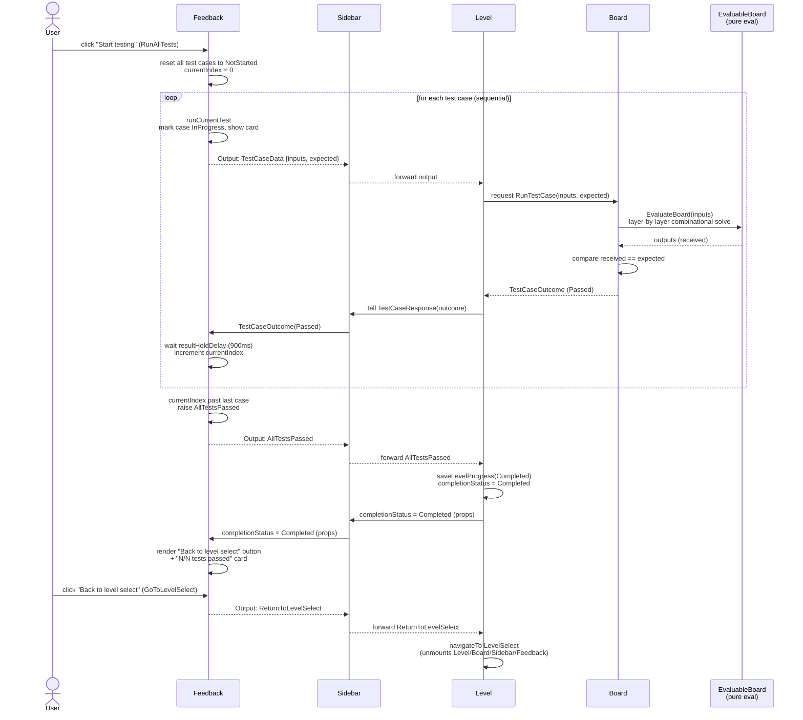

## Sequence diagram (golden path)

Component-level view of the same flow, from clicking "Start testing" to the "Back to level select" button appearing. Assumes every test case passes on the first try.

